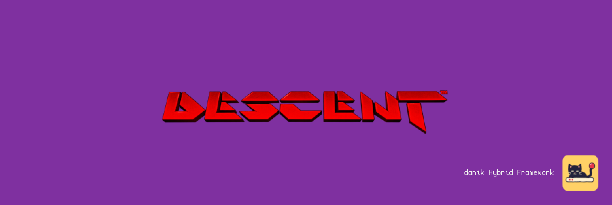
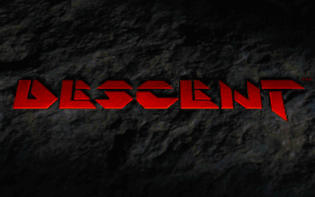
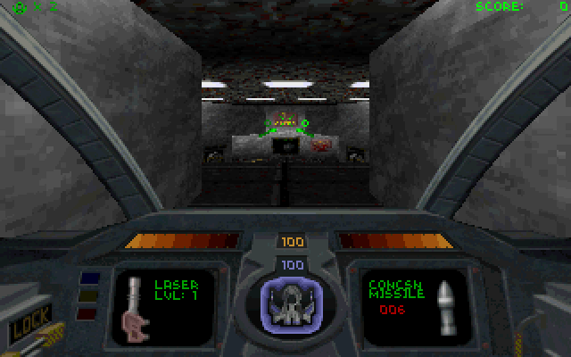

# DXXRebirth for MiSTer

Descent and Descent II on [MiSTer FPGA](https://github.com/MiSTer-devel/Main_MiSTer/wiki) as a hybrid port.

The games themselves are [DXX-Rebirth](https://www.dxx-rebirth.com/) (D1X-Rebirth and D2X-Rebirth), the source port of the Descent and Descent II engines, with its software renderer. They run on the MiSTer's ARM CPU. The DXXRebirth FPGA core provides native 15kHz video (CRT, VGA and HDMI) at 320x200 or 320x240, 44.1kHz audio, the music on its FM chip or MIDI synthesizer, and keyboard, mouse and gamepad input with rumble. The two halves talk through shared DDR3 memory.

> **Beta.** Expect rough edges and please report problems in the issues.
>
> **Disclaimer:** AI is being extensively used to speed up development, but the project is well-maintained and supported.

  
  

## Requirements

- **danik_hybrid_ports**, the launcher (`Scripts/danik_hybrid_ports.sh`): run it **once** from the MiSTer's `Scripts` menu. It starts the game whenever its menu entry is loaded, keeps running after a reboot, and serves all our hybrid ports; its screen picks which ports and games to have, and can keep them up to date through `update_all`. Without it the core says "Game not running".
- **Game data**, which is not included: your own copy of Descent and/or Descent II (the versions sold by GOG and Steam work), or the free shareware and demo versions. One of the two games is enough.
- **Recommended:** a gamepad with two analog sticks and analog triggers, like an Xbox or PlayStation controller. A gamepad without them works but is not recommended. The game can also be played with a keyboard and mouse.

## Installation

With `update_all` (Downloader 2.4 or newer, which update_all keeps up to date):

1. Copy [`downloader_danik_hybrid_ports.ini`](https://raw.githubusercontent.com/ItsDanik/Hybrid_MiSTer/main/launcher/downloader_danik_hybrid_ports.ini) to the root of your SD card (`/media/fat`).
2. Run `update_all`. That installs the launcher, **danik_hybrid_ports**, in `Scripts`.
3. Run **danik_hybrid_ports** from the `Scripts` menu, tick the games you want and press *X: Apply*. They are installed, and update_all keeps them up to date.
4. Copy **everything** in the folder of your Descent, of your Descent II, or of both, to `/media/fat/games/dnk/DXXRebirth/`, all the files as they are, into that one folder. Each game is known by its files:

   | Game | Files |
   |---|---|
   | Descent | `descent.hog`, `descent.pig` |
   | Descent II | `descent2.hog`, `descent2.ham`, `descent2.s11`, `descent2.s22`, `alien1.pig`, `alien2.pig`, `fire.pig`, `groupa.pig`, `ice.pig`, `water.pig`; the movies `intro-l.mvl`, `other-l.mvl`, `robots-l.mvl` |
   | Descent II demo | `d2demo.hog`, `d2demo.ham`, `d2demo.pig` |

   The shareware version of Descent has the same two file names as the full game. Of the Descent II movies the low resolution ones (`-l.mvl`) are the size of the screen; if only the high resolution ones (`-h.mvl`) are there, they are scaled down. Missions (`.hog` with `.msn` or `.mn2`) go into `games/dnk/DXXRebirth/descent/missions/` (Descent) and `descent2/missions/` (Descent II).
5. Load the game from the `Other` menu, e.g. **dnk-Descent**.

> [!NOTE]
> The game data can go on a USB drive instead, into the same folder there (`/media/usb0/games/dnk/DXXRebirth/`): the game looks for it there first, and then keeps its settings and saved games there as well. Everything else stays on the SD card.

Loaded by itself (`_Other/dnk/`), the core shows a list of the games whose data is there. Pilots, settings, saved games and demos are in `games/dnk/DXXRebirth/descent/` and `descent2/`. The log is in `/media/fat/logs/dnk/DXXRebirth/dxxrebirth.log`.

## OSD options

| Option | |
|---|---|
| Aspect ratio, Scale, Scandoubler Fx, Stereo Mix | as in other cores |
| FPS Counter | shows the pictures per second in the top left corner |
| HDMI Only | as in the other hybrid ports, for resolutions of 640x400 and more: DXXRebirth has none, so nothing changes here |
| CRT Options | **Horizontal Size**: the picture's width **Horizontal Pos**: moves it left or right **Vertical Pos**: moves it up or down **HUD (Top)**: moves the HUD's top lines 0 to 24 lines down from the top edge (default 0), at 240 lines **HUD (Bottom)**: lifts the cockpit, the status bar and the HUD's bottom lines 0 to 24 lines off the bottom edge (default 0), at 240 lines  For a 15kHz screen: fits the picture to it and keeps the HUD out of the overscan. HDMI is not affected; not there with `forced_scandoubler=1` |
| Sound Volume, Music Volume | **Sound Volume**: the sound effects, 0% to 100% (default 100%) **Music Volume**: the music, 0% to 100% (default 100%)  On top of the volumes in the game's own *Sound effects & music* options |
| Resolution | **320x200**: the games' own (default) **320x240**: the view fills the whole screen  With 240 lines the cockpit, the status bar and the HUD are drawn over the view at the HUD margins; menus, briefings and movies stay 320x200, centred |
| Music | **MIDI**: an MT32-pi when one is connected and on, else the core's MIDI synthesizer (default) **FM chip**: the core's OPL2, as on a Sound Blaster |
| SoundFont | **Default**: GeneralUser GS, which comes with the port **1 to 7**: your own `.sf2` files in `games/dnk/SoundFonts/`, in the order of their names  The SoundFont of the core's MIDI synthesizer |
| MT32-pi | only while one is connected: on or off, its synth, ROM and SoundFont |
| Rumble | **On**: the controller rumbles when the ship is hit, fires, hits a wall or explodes, while the fusion cannon charges and while the mine shakes (default) **Off**: no rumble |
| Cheats | **Invulnerability**: nothing hurts you **Robots Don't Fire**: robots hold their fire **Rapid Fire**: weapons fire faster **Ghost (No Clipping)**: fly through walls **Turbo**: the ship flies faster **Homing Weapons**: every shot homes in (Descent II) **Bouncy Weapons**: shots bounce off walls (Descent II) **Robots Kill Robots**: robots fight each other (Descent II) **Give All**: all weapons and keys, full shields and energy **Kill Reactor**: destroys the reactor **Next Level**: completes the level **Exit Path**: shows the way to the exit  The games' own cheats, for one player. As with the typed cheats, the score goes to 0 |
| Save Diagnostic Report | the last line: see [If something is wrong](#if-something-is-wrong) |

## Controls

- **Keyboard and mouse:**

| Key | Action |
|---|---|
| Arrow keys, mouse | Turn and pitch |
| W / S | Accelerate / reverse |
| A / D | Slide left / right |
| C / X | Slide up / down |
| Q / E | Bank left / right |
| Left Alt | Slide: the arrow keys slide while it is held |
| Ctrl, left mouse button | Fire primary weapon |
| Space, right mouse button | Fire secondary weapon |
| F | Fire flare |
| B | Drop bomb |
| 1-5 / 6-0 | Select primary / secondary weapon |
| , / . | Next primary / secondary weapon |
| R | Rear view |
| Tab | Automap |
| Left Shift / H / T | Afterburner / headlight / energy to shield (Descent II) |
| Esc | Game menu (automap, options, save, load, abort) |
| F2 / Alt+F2 / Alt+F3 | Options / save game / load game |
| F3 | Cockpit, status bar or full screen view |
| F1 | Help: all keys |

- **Gamepad** (default mapping):

| Button | Action |
|---|---|
| Left stick, D-pad | Turn and pitch |
| Right stick | Slide left / right and up / down |
| R2 (RT / R2) | Fire primary weapon |
| L2 (LT / L2) | Fire secondary weapon |
| Y (Xbox X / PlayStation Square) | Fire flare |
| X (Xbox Y / PlayStation Triangle) | Drop bomb |
| B (Xbox A / PlayStation Cross) | Accelerate |
| A (Xbox B / PlayStation Circle) | Reverse |
| L (LB / L1) | Next primary weapon |
| R (RB / R1) | Next secondary weapon |
| Select | Rear view |
| Start | Game menu: automap, options, save, load, abort. Closes the automap and the menus too |

Change the buttons in the OSD under *Define DXXRebirth buttons*. *Menu OK* and *Menu Back* there are only needed for a spare button without a game function. While the OSD is open, the game gets no input.

> [!WARNING]
> A button left without a name in *Define DXXRebirth buttons* does not reach the game at all, except L2/R2, L3/R3 and *Menu OK* / *Menu Back*. Name every button there, or leave the definition as it is. To go back to the default buttons, delete `config/inputs/DXXRebirth_*_input_*_v3.map` (each game has its own) on the SD card.

The game's own menu can change what each gamepad button does: *Options*, *Controls*, *Customize joystick* (there, Select clears a binding and holding Start resets all of them). Change the actions there rather than in the OSD; a button the OSD leaves without a name never reaches the game, so its menu cannot bind it.

Naming a pilot or a saved game without a keyboard: up/down changes the last character, right adds one, left removes one. A game saved without a description gets the date and time.

## If something is wrong

If the game stutters, the sound breaks up or something else is wrong, open the OSD while it happens and pick **Save Diagnostic Report**, the last line of the menu. The game keeps running; MiSTer's info box says the report is saved in `games/dnk/diagnostics/` on the SD card. Send that file (`DXXRebirth_<date>_<time>.zip`) with a few words on what went wrong.

The report has the setup (versions, the video and audio lines of `MiSTer.ini`, the OSD settings), how the last 60 seconds went, the game's log and a screenshot. Nothing else: no network settings, addresses, saved games or lists of your files.

## Building

How the port works, how to build it and notes for development: [NOTES.md](NOTES.md).

## Support

If you enjoy this project, you can support my work on [Patreon](https://www.patreon.com/itsdanik).

## Credits

- **[DXX-Rebirth](https://www.dxx-rebirth.com/)** ([source](https://github.com/dxx-rebirth/dxx-rebirth)) by Kp, Christian Beckhäuser and the DXX-Rebirth contributors, based on the Descent and Descent II source code released by Parallax Software.
- **[PhysicsFS](https://icculus.org/physfs/)** by Ryan C. Gordon, **[libADLMIDI](https://github.com/Wohlstand/libADLMIDI)** by Vitaly Novichkov and Joel Yliluoma (the music's sequencer and instruments), **SDL_image** and **SDL_mixer**.
- **[SDL](https://libsdl.org)** by Sam Lantinga and contributors.
- **[GeneralUser GS](https://www.schristiancollins.com/generaluser.php)** by S. Christian Collins: the SoundFont of the core's MIDI synthesizer, which comes with the port, its licence next to it.
- **[MiSTer](https://github.com/MiSTer-devel)** by Sorgelig and the MiSTer-devel contributors: the framework and Template_MiSTer.
- **[MiSTer Frontier](https://github.com/MiSTerOrganize/MiSTer_Frontier)** by MiSTer Organize: thank you for the inspiration. Hybrid cores on the MiSTer, and the way their game is launched (a daemon that watches the loaded core and runs a script from its games folder), were inspired by MiSTer Frontier.

This project and its maintainers are in no way associated with or endorsed by Parallax Software, Interplay Entertainment or the DXX-Rebirth project. It does not include any game data.

## License

The top-level scripts, tools and documentation are licensed under the [GPL-3.0](LICENSE). The components keep their own licenses: the part of the shared framework the game is linked with (`hybrid/hps/`) is GPL-2.0-or-later, the rest of `hybrid/` GPL-3.0 except where its files say otherwise, DXX-Rebirth is under its own license (`dxxrebirth/COPYING.txt`: the Parallax license for the original source, GPL-3.0 for what was added since), PhysFS and SDL_image are zlib, libADLMIDI is LGPL-3.0, SDL and the SDL drivers in `hybrid/sdl2` are zlib, the FPGA core and the MiSTer framework are GPL-2.0 (`core/LICENSE`, with the core's own sources GPL-2.0-or-later).
